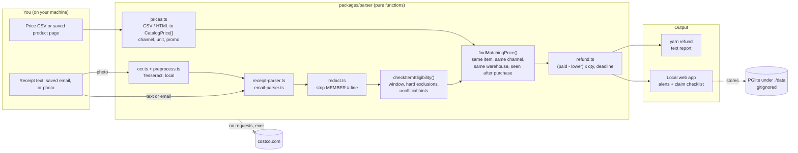

# Receipt Rewind

**A local price-drop checker. Works with Costco receipts.**

Receipt Rewind compares what you paid on a receipt with a price you saw later. If the price went down and you may still be inside the price match window, it tells you how much, by when, and where to ask. You run it on your own machine. It never logs into Costco, never scrapes costco.com, and never files a claim for you.

> Receipt Rewind is an independent personal project. It is not affiliated with, endorsed by, or sponsored by Costco Wholesale Corporation. "Costco" is used only to describe the receipts this tool reads. Costco decides every price match request.

---

## Contents

1. [What it does](#what-it-does)
2. [Why I built it](#why-i-built-it)
3. [Quickstart](#quickstart)
4. [How it works](#how-it-works)
5. [Design decisions and tradeoffs](#design-decisions-and-tradeoffs)
6. [Safety and privacy](#safety-and-privacy)
7. [Accuracy caveats](#accuracy-caveats)
8. [Using it on your own receipts](#using-it-on-your-own-receipts)
9. [Testing](#testing)
10. [Project layout](#project-layout)
11. [Configuration](#configuration)
12. [Roadmap](#roadmap)
13. [Disclaimer](#disclaimer)

---

## What it does

You give it two things:

1. **A receipt.** Pasted text, a saved digital receipt email, or a photo (photo OCR runs locally).
2. **Prices you saw later.** A small CSV you type, or a product page you saved from your browser.

It gives you back:

- every line it could read off the receipt (item number, description, quantity, price),
- which lines it thinks are worth asking about and which it skipped, with a reason for each,
- the difference per line: `(what you paid - lower price you saw) x quantity`,
- the deadline for each line and how many days are left,
- a short checklist of where to go and what to bring.

Then you decide whether to ask. The tool doesn't contact Costco, and Costco has the final say on every request.

Example run against the fake sample receipt that ships with the repo (shortened):

```text
$ yarn refund --receipt fixtures/sample-receipt.txt --prices fixtures/public-prices.csv --as-of 2026-11-15

Receipt Rewind
Receipt date: 2026-11-01
Warehouse: 116
Channel: warehouse
Compared as of: 2026-11-15
Items parsed: 6

Possible price match: $12.40. Costco decides every claim.
$5.40 of that has an unofficial caveat. See the notes.

KS OLIVE OIL (#1111111)
  Paid $14.99, current $11.49, qty 1
  Difference $3.50. 16 days left (until 2026-12-01).
  Ask at the Returns counter at warehouse #116, where you bought it. Bring your membership card. Costco decides. This app doesn't contact Costco.

KS VITAMINS (#4444444)
  Paid $24.97, current $19.97, qty 1
  Difference $5.00. 16 days left (until 2026-12-01).
  Note: Unofficial hint: price ends in .97, which shoppers often read as clearance. Costco doesn't publish what endings mean and may decline clearance items. Ask.
  ...

Not claimed:
  ROTISSERIE CHICKEN (#2222222): No lower price that counts in the supplied prices.
  GIFT CARD 50 (#5555555): No lower price that counts in the supplied prices.
    Note: Unofficial: gift cards are likely not adjustable. Ask.

Lower prices that don't count:
  KS OLIVE OIL (#1111111): $1.00 is from warehouse #1, not #116 where you bought it.

Policy: Price Match - Costco.com Orders (customerservice.costco.com, answer 628), version 30.0 (published 2026-11-20, last checked 2026-11-21). The 30-day warehouse window is an assumption.
```

The full run also lists paper towels ($3.50) and a fuel line ($0.40, with an "unofficial" note). Lines with a caveat stay in the total, and the report says how much of the total they make up, so you can decide whether to ask.

---

## Why I built it

### The problem

Costco will give members the difference when something they bought drops in price within a window after purchase. Costco's own US page for Costco.com orders says purchases that "reduce in price within 30 days of the date of purchase are eligible for a price match." Warehouse purchases are handled at the Returns counter of the warehouse where you bought the item.

In practice almost nobody keeps up with it. To claim, you'd have to remember what you bought, notice the price moved, figure out whether you're still inside the window, and then actually go ask. That's a lot of bookkeeping for $3.50 on olive oil, so the money just stays on the table. Multiply that across a household that shops at Costco every week and it adds up.

The math is simple. The tedious part is the remembering and the checking. That is exactly what software is good at.

### Why me

I love Costco and I shop there pretty regularly. When I found out about their price match policy, my first thought was how much money I'd probably already missed. Nobody is going back through every receipt to see if something dropped a few bucks a week later. So I wanted to build something that would let my agent check that for me.

### Why it's a portfolio piece and not a business

I looked at turning this into a paid product and decided not to, at least for now. The short version:

- **Warehouse claims can't be automated.** Costco handles them at the Returns counter. Software can't stand in line for you.
- **The companies that auto-filed claims didn't last.** Paribus (bought by Capital One in 2016) ended its price protection filing in January 2023. Earny's founder has said retailers and card issuers tightened the policies the product depended on. A tool that files claims at volume is building on someone else's goodwill.
- **Costco's terms rule out the "agent" version.** The site terms bar sharing account credentials and using "robots, agents or similar data gathering or extraction methods." A service that logs into members' accounts for them is the version I'm not willing to build.
- **The niche is already served.** CostRefund, BulkBack, CostPal and others track Costco receipts for a small fee, and none of them files claims either.

So I kept the honest version: a tool you run yourself that finds what you may be owed and tells you how to ask before the window closes.

---

## Quickstart

**Requirements:** Node.js 20 or newer and Yarn 1.x (`npm i -g yarn@1.22.22`, or prefix commands with `npx yarn@1.22.22`). Docker is optional and not needed below. No API keys are needed.

```bash
git clone https://github.com/Zach-beck/receipt-rewind.git
cd receipt-rewind
yarn install
yarn test
```

`yarn test` runs offline against fake fixtures. Today it runs 31 tests across 3 files.

### Command line check

```bash
yarn refund --receipt fixtures/sample-receipt.txt --prices fixtures/public-prices.csv --as-of 2026-11-15
```

Flags:

| Flag | Required | What it is |
| --- | --- | --- |
| `--receipt` | yes | A receipt text file, or a saved digital receipt email (`.html`) |
| `--prices` | yes | A price CSV, or a saved product page (`.html`) |
| `--as-of` | no | The date to compare as of, `YYYY-MM-DD`. Defaults to today |

The same receipt against a product page saved from costco.com:

```bash
yarn refund --receipt fixtures/sample-receipt.txt --prices fixtures/public-price-page.html --as-of 2026-11-15
```

This one finds nothing on purpose. A saved costco.com page shows online prices, and Costco doesn't match online prices against warehouse purchases, so the report lists them under "Lower prices that don't count."

A gas station receipt is recognized and skipped with a short note (exit code 0), since gas prices change daily.

`make refund` runs the first example for you.

### Local web app

```bash
yarn dev:local
```

This builds the shared and parser packages, then starts the API on http://127.0.0.1:3001 (this machine only) and the web app on http://localhost:5173. It uses an embedded database (PGlite) under `./data`. No Docker, no Redis, no object storage. `make local` does the same thing.

Then open http://localhost:5173:

1. Create a local account. The password only protects this app on your machine. It's stored as an argon2 hash under `data/`.
2. Open **Upload**.
3. Choose **Use sample** on the receipt form, then **Use sample** on the prices form.
4. Open **Price Alerts** and then a guide. The sample purchase is dated 10 days before today, so the window is still open.

### Price CSV format

```text
item_number,description,price,warehouse_id,observed_date,channel,unit
1111111,KS OLIVE OIL,11.49,116,2026-11-20,warehouse,each
```

| Column | Required | Meaning |
| --- | --- | --- |
| `item_number` | yes | Costco item number |
| `description` | no | Anything that helps you read the report |
| `price` | yes | The price you saw |
| `warehouse_id` | yes for warehouse prices | The warehouse where you saw it. It has to match the receipt (`WAREHOUSE #116` in the sample). A blank never matches |
| `observed_date` | no | The day you saw it. Prices from before the purchase or after `--as-of` are ignored |
| `channel` | no | `warehouse` (default for a CSV) or `online`. Online never matches a warehouse receipt |
| `unit` | no | `each` (default) or `lb`. Per-pound prices are skipped, since a receipt only shows the total |
| `promo_end` | no | Last day of a dated promotion. The deadline becomes the earlier of this and 30 days |
| `promo_limit` | no | Promotional item limit. Only that many units count |

A saved page works if it has an `<article data-item-number="1111111">` with a `$11.49` price, or a table row with the item number, name and price. Saved pages count as online prices.

### Receipt formats

- Register-style text like `fixtures/sample-receipt.txt` (`WAREHOUSE #116`, two or more spaces before the price, `A` tax flag).
- The text format in your Costco account's Orders & Purchases: single spaces before the price, `Y`/`N`/`B` tax flags, 4-digit produce numbers, inline `2 @ 5.25 = 10.50` quantities, instant savings that name their item (`900001 /7100003 2.00-`), CA bottle deposits, `Date: YYYY-MM-DD` headers and store lines like `SAMPLETOWN #123`. See `packages/parser/src/__tests__/member-receipt-format.test.ts` for a made-up example.
- A digital receipt email saved as HTML.

---

## How it works

### Architecture



There's no network call in the core path. The only network use is optional: Tesseract may download language data the first time you use a photo. The text and email paths are fully offline.

### Data flow, step by step

1. **Read the receipt.** `parseReceiptText()` in `refund.ts` decides the input type. If the text looks like HTML it goes to `email-parser.ts` (digital receipt emails). Otherwise each line goes to `receipt-parser.ts`. Photos go through `preprocess.ts` (sharp) and `ocr.ts` (Tesseract) first, then the same line parser.
2. **Parse lines.** The line parser pulls out the warehouse number (`WAREHOUSE #116` or a store line like `SAMPLETOWN #123`), the receipt date, the subtotal, and each item line: item number, description, quantity, unit price, shelf price and tax flag. Instant savings are applied to the item they name, and bottle deposits are counted toward the subtotal check but not the item price. A confidence score compares parsed items plus deposits against the printed subtotal. Gas station receipts are recognized and skipped.
3. **Redact.** Before anything is saved in the web app, `redact.ts` replaces a printed `MEMBER #` number with `[redacted]`. The CLI never writes anything.
4. **Read prices.** `prices.ts` turns a CSV or a saved HTML page into a list of `{ itemNumber, description, price, warehouseId, observedDate, channel, unit, promoEnd, promoLimit }`.
5. **Check eligibility.** `checkItemEligibility()` in `receipt-parser.ts` applies the window and the one documented hard exclusion (precious metals), and attaches unofficial hints. See the next section.
6. **Find a lower price.** `findMatchingPrice()` in `refund.ts` keeps prices for the same item number, in the same channel, observed on or after the purchase date and on or before the "as of" date. For a warehouse receipt the price must carry that same warehouse number. Per-pound prices are skipped. Every lower price it skips is listed with the reason.
7. **Do the math.** `evaluateLine()` computes `(paid - lower) x quantity` (capped at a promo limit), rounds to cents, and attaches the deadline (the earlier of 30 days and a promo end) and days remaining. `formatRefundReport()` prints it. In the web app, the API builds a step-by-step claim guide from the same numbers.

### The rule engine

| Rule | Where | What it does | Source |
| --- | --- | --- | --- |
| 30-day window | `ADJUSTMENT_WINDOW_DAYS` in `packages/shared/src/types.ts` | Line is out after 30 days | Costco's US page documents 30 days for Costco.com orders. The warehouse window is an assumption |
| Promotion end | `promo_end` in the price file | Deadline is the earlier of 30 days and the promo end | Costco's US page |
| Promo limit | `promo_limit` in the price file | Only that many units count | Costco's US page |
| Precious metals | `HARD_EXCLUSIONS` | Line is out | Costco's US page |
| Same channel | `findMatchingPrice()` | Online prices never match warehouse receipts, and the reverse | Costco's US page |
| Same warehouse | `findMatchingPrice()` | Price must carry the purchase warehouse number. A blank never matches | Costco sends warehouse claims to the warehouse where you bought it |
| Per-pound prices | `unit` in the price file | Skipped | A receipt shows only the total |
| Price ending `.97` | `analyzePriceEnding()` | Hint only, on the shelf price before savings | **Unofficial.** Costco doesn't publish what endings mean |
| Fuel, pharmacy, tobacco, gift cards, special orders | `SOFT_EXCLUSIONS` | Hint only: "likely not adjustable, ask" | **Unofficial.** Not on Costco's price match page |

### Why there's no model at runtime

A Costco receipt is already structured text. The rules fit in a table. So the core check is plain code: parse, filter, subtract. I think of this as Context Engineering: the receipt, the prices you saw and the written-down rules are the context, and the code applies them the same way every time. There's nothing to generate, so there's nothing to hallucinate, and every number can be traced back to a line on the receipt and a line in your price file.

### Web app stack

- `packages/web`: React + Vite + Tailwind.
- `packages/api`: Fastify. In local mode it uses PGlite (embedded Postgres) and an in-memory store. With Docker it can use Postgres, Redis and MinIO instead.
- `packages/shared`: Drizzle schema, shared types, warehouse list.
- `packages/parser`: everything above. No database, no network.

---

## Design decisions and tradeoffs

These came out of a review of the original repo (`docs/decisions-review.md`) and an outside terms and accuracy review.

| Decision | Why | What it costs |
| --- | --- | --- |
| **You bring the receipt and the prices** | No logins, no scraping, nothing that touches a Costco account. Works the same for anyone | You do some typing or saving. The tool can only find drops you show it |
| **No Costco login, ever** | Costco's terms bar sharing credentials and using agents or extraction tools on the site. A login also means holding the keys to an account with payment methods on it | No automatic receipt import. Warehouse receipts live in your signed-in Costco account, so you export them yourself |
| **No scraping of costco.com** | Same terms. The old schema had a `web_scrape` price source with nothing behind it. I removed it so the door isn't even labeled | Prices come from you: a CSV or a page you saved |
| **You file the claim** | Warehouse claims happen at the Returns counter. Online claims go through Costco's own form. Auto-filing is the model that failed for Paribus and Earny | One more step for you. It's also the step that keeps the tool honest |
| **No model in the core check** | The input is structured and the rules are short. Plain code is cheaper, faster, testable and explainable | It can't read a badly damaged receipt or reason about edge cases. It flags them instead |
| **Local mode is the default** | Docker, Postgres, Redis and MinIO were too much to try the thing. PGlite plus files under `data/` is enough for one person | Not built for many users. The Docker path still exists if you want it |
| **No membership number stored** | The math doesn't need it. You bring your card to the counter anyway | Settings no longer save it, and saving settings clears an old one |
| **Receipt text is redacted before storage** | A printed `MEMBER #` line would otherwise sit in the database | Redaction is a pattern match. It covers the formats in the fixtures, not every possible layout |
| **One person's price report is enough for an alert in local mode** | The old two-reporter rule meant a single user never got an alert | You're trusting your own input. The Docker scheduled job still uses the stricter rule |
| **No accuracy percentages** | The old README claimed 95% item and 98% price accuracy with no measured corpus behind it | Less impressive marketing. More honest |
| **Portfolio, not a paid product** | Warehouse claims can't be automated, the niche is already served, and a cut of refunds rewards claim volume | No revenue. That's fine for now |

---

## Safety and privacy

- **Runs on your machine.** The CLI reads two files and prints a report. In local mode the API listens on `127.0.0.1` and the web app on localhost. Set `HOST` in `.env` only if you really want other devices to reach it.
- **No Costco login.** The tool never asks for, stores or uses Costco credentials.
- **No scraping.** Nothing in the code requests costco.com. Price sources are `receipt_upload`, `manual_entry`, `public_page` (a page you saved) and `catalog_import` (a CSV you wrote).
- **No auto-filed claims.** The tool tells you what to ask for. You ask.
- **No membership number stored.** Not in the profile, not in receipt text (redacted on save).
- **Local app login is local.** Passwords are argon2-hashed, sessions are httpOnly cookies, state-changing routes use a double-submit CSRF cookie, and login attempts are rate limited.
- **Your real receipts stay out of git.** Everything in `fixtures/` and the tests is made up. `data/`, `data/private/`, `private/`, `*.private.*`, `receipts-real/` and `.env` are gitignored.
- **Secrets live in `.env`.** Optional email and push keys go in `.env`, which is gitignored. The MinIO values in `.env.example` are stock local defaults, not secrets, and shouldn't be reused on a reachable server.

---

## Accuracy caveats

I want to be upfront about what the rules are based on. I checked Costco's own pages on Nov 21, 2026.

**What Costco's US page actually says** ("Price Match - Costco.com Orders", customerservice.costco.com, answer 628, Version 30.0, published 11/20/2026):

- Purchases that reduce in price within 30 days of the date of purchase are eligible, for members other than resellers.
- Items with specific sale dates must be requested within both the promotion dates and 30 days of purchase.
- Promotional item limits apply. Precious metals are not eligible.
- Costco does not price match other retailers.
- **Costco does not price match Costco warehouse prices for Costco.com purchases.**
- Costco.com purchases: use the "Request a Price Match" form on that page. Credits typically land in 5 to 10 business days.
- Warehouse purchases: "inquire at the Returns counter at the Costco location where you made the purchase." Costco.com can't process them.
- Costco can deny any request at its sole discretion and may restrict the policy.

**What that means for this tool:**

1. **The warehouse window isn't spelled out on the US page.** The 30-day rule is stated on the Costco.com orders page. The only Costco page I found that states 30 days for in-warehouse purchases is Costco Canada's. The tool uses 30 days for both. Treat the warehouse deadline as a reasonable assumption, not a quote.
2. **The `.97`, `.00` and `.88` price-ending rules are unofficial.** Costco doesn't publish a price-ending decoder. These come from shopper lore, and reports conflict. So a `.97` line stays in the check and gets a note that Costco may decline clearance items. The check runs on the shelf price before instant savings, so a discount that happens to land on `.97` isn't flagged. The tool makes no claim about `.00` or `.88`.
3. **The category exclusions are unofficial.** Fuel, pharmacy, tobacco, gift cards and special orders aren't listed on the price match page. Costco lists precious metals, resellers, promo limits, and separate rules for the Special Order Kiosk and installed products. So these show up as "likely not adjustable, ask" notes instead of being dropped. Precious metals are the one documented exclusion and are dropped.
4. **Online prices vs warehouse prices.** A product page saved from costco.com shows the online price, which includes shipping and handling. Costco says those don't cross-match. Comparing a saved costco.com page against a warehouse receipt can show a "refund" Costco won't give. So every price has a channel, saved costco.com pages count as online, and the tool only compares like with like. A price with no warehouse number never matches a warehouse receipt.
5. **Where to ask.** Older versions said "membership counter or call 1-800-774-2678." That number is Costco's general Membership and Warehouse line, not a listed claim route. Now warehouse purchases point to the Returns counter at the purchase warehouse, and Costco.com orders point to the online form.
6. **Promotion end dates need your input.** A promo-dated drop has to be claimed before the promotion ends, even inside 30 days. Add `promo_end` to the price row and the deadline follows it. Without it, the tool can't know.
7. **Per-pound items.** Deli and meat sold by weight print only a total on the receipt, so a per-pound price can't be compared. Those are skipped.
8. **Costco decides.** Every dollar figure is an estimate of what you might ask for.

---

## Using it on your own receipts

How I run it on my own receipts without any of them touching git:

1. Get your receipts yourself. Warehouse receipts are in your Costco account under Orders & Purchases. Save or print them as PDFs or copy the text. Costco.com orders also arrive by email.
2. Put them in `data/private/` (gitignored). Example layout:

   ```text
   data/private/
     receipts/2026-11-01-wh116.txt
     prices/2026-11-20.csv
   ```

3. Run the check:

   ```bash
   yarn refund --receipt data/private/receipts/2026-11-01-wh116.txt --prices data/private/prices/2026-11-20.csv
   ```

4. Before you commit anything, run `git status` and make sure nothing under `data/` shows up.

---

## Testing

```bash
yarn test        # parser unit tests, offline, fake fixtures only
yarn typecheck   # TypeScript across all packages
```

What's covered today (`packages/parser/src/__tests__/`, 31 tests):

- `receipt-parser.test.ts` (17 tests): item lines, quantity lines, warehouse id, date, subtotal, multi-item confidence, non-taxable items, price-ending hints (including checking the shelf price, not the price after savings), the 30-day window, soft hints for fuel and gift cards, and the precious-metals exclusion.
- `member-receipt-format.test.ts` (2 tests): a made-up receipt in the Orders & Purchases text format (single spaces, Y/N/B tax flags, 4-digit items, inline quantities, linked instant savings, bottle deposits, ISO and one-line headers).
- `refund.test.ts` (12 tests): the CSV fixture, a saved HTML price page, the sample receipt end to end, Returns counter wording (and no phone number), online prices never matching a warehouse receipt, blank warehouse numbers never matching, per-pound prices, promotion end dates and limits, fuel receipts, a digital receipt email, the online claim form, and membership number redaction.

CI (`.github/workflows/ci.yml`) builds the shared and parser packages, typechecks the API and web app, runs the parser tests, and builds the web app on every push and pull request to `main`.

**What isn't measured yet.** There's no corpus of real receipts in the repo, on purpose, and I don't publish accuracy numbers. I did run it privately on my own receipts, which is how I found that the first version couldn't read the Orders & Purchases text format at all and that a blank warehouse number let prices from other stores sneak in. Both are fixed and covered by made-up tests. Next is a longer private self-test: run it on my own receipts for 30 days and track three numbers, claimable drops found, dollars found, and minutes per check. If I publish anything, it'll be those aggregates, never the receipts.

---

## Project layout

```text
packages/shared    Drizzle schema, warehouse list, shared types (incl. ADJUSTMENT_WINDOW_DAYS)
packages/parser    receipt and email parsing, OCR, price files, eligibility, refund math, CLI, tests
packages/api       Fastify API: auth, receipts, prices, alerts, claim guide. Local mode or Postgres
packages/web       React app: upload, receipts, alerts, guide, settings
fixtures           fake receipt, fake email, fake price CSV, fake saved price page
scripts            dev-local.sh (local mode), setup.sh (Docker path)
docs               decisions-review.md
```

---

## Configuration

You don't need a `.env` for the quickstart. Copy `.env.example` to `.env` only to override defaults. `.env` is gitignored.

| Name | Purpose | Default in local mode |
| --- | --- | --- |
| `LOCAL_MODE` | `1` uses the embedded database and skips Redis and object storage | `1` |
| `DATA_DIR` | Where the local database and photos live | `./data` |
| `SESSION_SECRET` | Signs cookies. Change it if anyone else can reach the server | dev-only value |
| `PORT` | API port | `3001` |
| `HOST` | API listen address | `127.0.0.1` (this machine only) |
| `WEB_URL` | Web origin | `http://localhost:5173` |

Optional, only for the Docker path or extras: `DATABASE_URL`, `REDIS_URL`, `S3_*`, `VAPID_*`, `VITE_VAPID_PUBLIC_KEY`, `RESEND_API_KEY`, `FROM_EMAIL`, `API_URL`, `NODE_ENV`, `COOKIE_DOMAIN`.

**Optional Docker stack:** `docker compose up -d` starts Postgres, Redis and MinIO. Set `LOCAL_MODE=0` in `.env`, then run `yarn db:migrate`, `yarn db:seed` and `yarn dev`. `make dev` starts Docker and the app together.

---

## Roadmap

Done:

- [x] Read the Orders & Purchases receipt text format
- [x] Soften the `.97` / `.00` / `.88` rules to hints and keep those lines tracked
- [x] Split hard exclusions (precious metals) from soft ones (fuel, pharmacy, tobacco, gift cards, special orders)
- [x] Track channel (warehouse vs Costco.com) on prices and receipts, and never cross-compare
- [x] Point warehouse claims to the Returns counter and Costco.com claims to the online form
- [x] Promotion end dates and limits from the price file
- [x] Show the policy version and last-checked date, and "Costco decides every claim" next to totals
- [x] `data/private/` for real receipts, gitignored
- [x] Skip fuel receipts cleanly

Then:

- [ ] Run it on my own receipts for 30 days and write up the aggregate results
- [ ] Better photo OCR, fully offline (bundle language data)
- [ ] Price history per item
- [ ] Possibly other retailers' published price adjustment rules

Not planned: Costco logins, scraping, browser automation of a Costco account, auto-filed claims, or taking a cut of anyone's refund.

---

## Disclaimer

Receipt Rewind is an independent project. It is not affiliated with, endorsed by, or sponsored by Costco Wholesale Corporation. Costco and Kirkland Signature are trademarks of their owners and are used here only to describe compatibility. The tool doesn't use Costco logos or brand assets.

Costco's price match policy is Costco's, and it can change. This tool summarizes what Costco's public pages said when I last checked and adds some unofficial heuristics, labeled as such. It isn't legal or financial advice. It doesn't guarantee any refund, and Costco may deny any request at its sole discretion.

## License

MIT. See [LICENSE](LICENSE).
